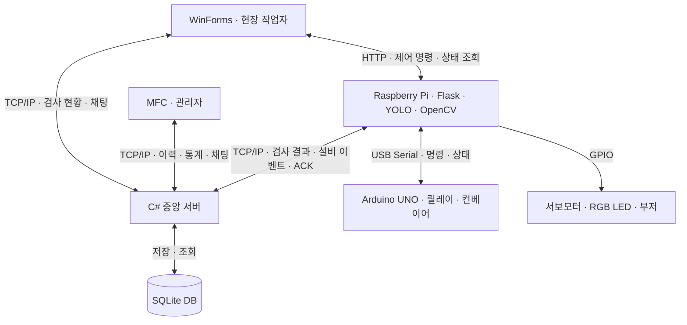
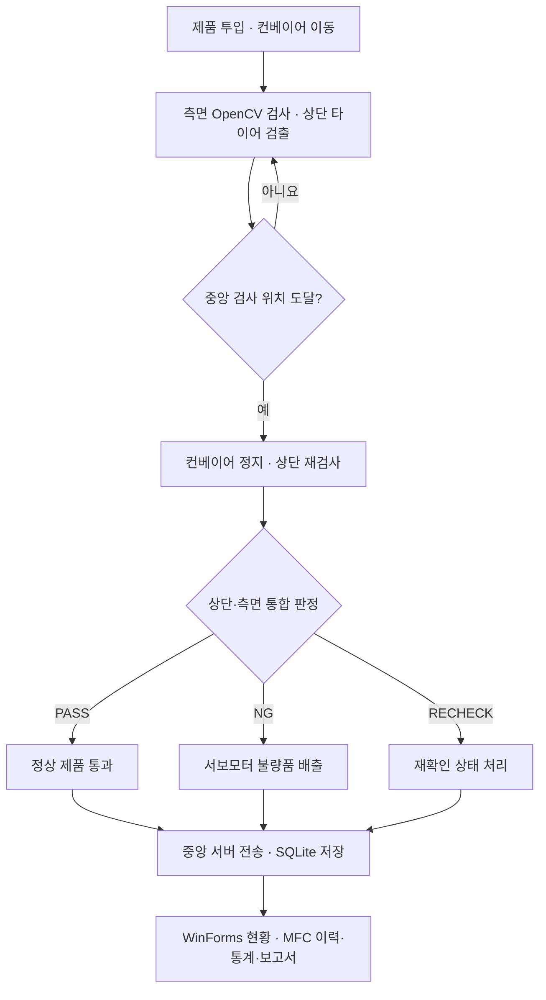

# 🏭 Tire Production Management System

### MFC·WinForms 기반 타이어 생산관리와 YOLO·OpenCV 기반 타이어 불량 검사

타이어의 **상단·측면 불량 검사**에  
**컨베이어 자동 제어, 불량품 배출, 생산 모니터링, 실시간 채팅, 통계·보고서**를 결합한  
**생산라인 모니터링·채팅 시스템**입니다.

---

## 💡 프로젝트 배경

생산라인에서는 불량을 판별하는 것뿐 아니라 검사 결과와 설비 상태를 작업자와 관리자가 함께 확인하고, 문제 발생 시 작업 상황을 공유할 수 있어야 합니다.

본 프로젝트는 **5인 팀 프로젝트**로, Raspberry Pi와 Arduino 기반 검사·제어 장치를 C# 중앙 서버, SQLite DB, WinForms·MFC 프로그램과 연결했습니다.

> **제품 검사 → 정상·불량 판정 → 자동 분류 → 데이터 저장 → 생산 현황 공유 → 통계·보고서**

각 기능을 하나의 흐름으로 통합하여, 검사 장치에서 발생한 데이터가 현장 작업자와 관리자 화면까지 이어지도록 구현했습니다.

---

## 📌 프로젝트 개요

| 항목 | 내용 |
|---|---|
| **프로젝트명** | 생산라인 모니터링·채팅 시스템 |
| **주제** | 타이어 불량 검사 및 실시간 설비 제어·생산 관리 |
| **프로젝트 유형** | 5인 팀 프로젝트 |
| **팀장 / 부팀장** | 김초아 / 조시현 |
| **검사 방식** | 상단 YOLOv11n 검사 + 측면 OpenCV 검사 |
| **하드웨어** | Raspberry Pi, Arduino UNO, 카메라, 컨베이어, 스텝모터·드라이버, 릴레이, 서보모터, RGB LED, 부저, 비상정지 스위치 |
| **중앙 서버** | C# 기반 TCP/IP 서버 |
| **현장 작업자 프로그램** | C# WinForms |
| **관리자 프로그램** | C++ MFC |
| **장비 제어 API** | Python·Flask 기반 HTTP API |
| **데이터베이스** | SQLite |

## 🎯 프로젝트 목표

- 영상 분석을 통한 타이어 정상·불량 판정
- 상단·측면 검사 결과의 제품별 통합
- 검사 위치에 따른 컨베이어 정지 및 재검사
- 서보모터를 이용한 불량품 자동 배출
- 비상정지 회로와 프로그램 상태 연동
- 작업자·관리자 간 실시간 생산 정보 및 채팅 공유
- 검사 이력·설비 이벤트·통계·일일 보고서의 데이터 통합

---

## 🧰 개발 환경 / 기술 스택

| 구분 | 사용 기술 | 적용 영역 |
|---|---|---|
| **Language** | C#, C++, Python | 중앙 서버, PC 프로그램, 검사·자동화 |
| **Vision / AI** | YOLOv11n, OpenCV, LabelImg | 상단 검출·학습 데이터 라벨링·측면 영상 분석 |
| **GUI** | WinForms, MFC | 현장 작업자·관리자 프로그램 |
| **HTTP API** | Flask | 장비 제어, 상태 조회, 영상 제공 |
| **Network** | TCP/IP, JSON | 검사 결과·설비 상태·채팅 데이터 전송 |
| **Serial** | USB Serial | Raspberry Pi–Arduino 명령·상태 교환 |
| **Database** | SQLite | 검사 이력·사용자·설비·채팅·인수인계 저장 |
| **Hardware** | Raspberry Pi, Arduino UNO, GPIO, gpiozero | 컨베이어·서보모터·LED·부저 제어 |
| **Development** | Visual Studio, Windows, Raspberry Pi 환경 | PC 프로그램 빌드 및 장치 실행 |

---

## 🔄 시스템 구성

### 데이터 통신과 장비 제어

| 통신 경로 | 방식 | 전달 내용 |
|---|---|---|
| Raspberry Pi ↔ 중앙 서버 | TCP/IP | 검사 결과, 설비 이벤트, Heartbeat, 저장 ACK |
| WinForms·MFC ↔ 중앙 서버 | TCP/IP | 검사 이력, 통계, 설비 상태, 로그인·채팅 등 |
| WinForms ↔ Raspberry Pi | HTTP | 장비 제어 명령 및 상태 조회 |
| Raspberry Pi ↔ Arduino UNO | USB Serial | RUN·STOP·PING 명령 및 상태 응답 |
| Raspberry Pi → 주변 장치 | GPIO | 서보모터, RGB LED, 부저 제어 |

**장비 제어 명령은 WinForms에서 Raspberry Pi에 HTTP로 직접 전달**하고, **검사 결과와 설비 상태 등은 중앙 서버에서 TCP/IP로 처리**하도록 구성했습니다.

---

## ✨ 주요 기능

### 🔍 1. YOLOv11n 기반 상단 불량 검사

타이어의 고무와 휠 상태를 기준으로 4개 클래스를 정의하고, 상단 카메라 영상에서 정상·불량을 판정합니다.

| 클래스 | 내용 | 판정 |
|---|---|---|
| `NORMAL` | 정상 타이어 | OK |
| `WHEEL_DAMAGE` | 휠 파손 | NG |
| `TIRE_DAMAGE` | 고무 파손 | NG |
| `BOTH_DAMAGE` | 휠·고무 동시 파손 | NG |

- 정상·불량 이미지 수집 및 LabelImg 객체 라벨링
- YOLO 학습 데이터 구성 및 모델 학습
- 상단 영상에서 타이어 위치와 결함 종류 검출
- 제품이 중앙 검사 위치에 도달하면 컨베이어 정지
- 정지 후 YOLO 결과를 최대 3회 재확인하고 측면 결과와 결합

### 📷 2. OpenCV 기반 측면 검사

측면 카메라에서 타이어 무늬와 파손 상태를 분석합니다.

- HSV 기반 배경 분리 및 타이어 영역 추출
- CLAHE와 Sobel을 이용한 무늬 특징 추출
- 특징 간 거리 비교를 통한 A·B형 타이어 구분
- 휠 노출과 타이어 파손 확인
- 판단이 불확실한 경우 `RECHECK` 처리

타이어 내부 휠 노출 등은 파손 판정에 반영하고, 다른 타이어 무늬도 별도로 구분하도록 구성했습니다.

### 🧩 3. 상단·측면 검사 결과 통합

두 카메라의 검사 작업을 별도 스레드에서 실행하고, 이동 중 수집한 측면 결과와 정지 후 상단 검사 결과를 통합합니다.

- 제품별 검사 결과와 타이어 ID 연결
- 측면 파손 반복 검출 여부를 이용한 판정
- 상단·측면 결과를 결합한 최종 PASS·NG 처리
- 검사 결과 누락·시간 초과·제품 연결 불확실 상황의 `RECHECK` 처리
- 결과를 한 제품 단위로 묶어 중앙 서버에 전달

### ⚙️ 4. 컨베이어 자동 제어 및 불량품 배출

카메라 검출 위치와 검사 상태를 컨베이어 동작에 연결했습니다.

- 타이어 중앙 위치 확인 후 컨베이어 정지
- 정지 상태에서 최종 검사 수행
- 정상 제품 통과 및 불량 제품 자동 배출
- 서보모터 배출 중 컨베이어 구동을 제한하는 인터록 적용
- WinForms 자동·수동 모드 및 장비 상태 연동

### 🛑 5. 비상정지 및 설비 상태 관리

Arduino의 입력 감지와 릴레이 제어를 이용하여 비상정지를 처리하고, 프로그램에도 비상 상태를 전달합니다.

- 비상정지 입력 감지 시 모터 펄스 중단
- 릴레이 OFF 및 컨베이어 정지
- Arduino ESTOP 이벤트를 Raspberry Pi에 전달
- RGB LED·부저를 통한 비상 상태 알림
- 비상정지 해제 후 자동 재가동을 막고 START 명령 대기
- 설비 상태와 이벤트를 중앙 서버·화면에 반영

### 🖥️ 6. WinForms 현장 작업자 프로그램

현장 작업자가 검사 상황을 확인하고 장비를 제어할 수 있도록 구성했습니다.

- 로그인 및 사용자 권한에 따른 프로그램 진입
- 컨베이어·서보모터 제어와 자동·수동 모드 전환
- Flask HTTP API를 통한 장비 제어 명령 전달
- 상단 YOLO·측면 OpenCV 영상 동시 모니터링
- 타이어 ID, 검사 결과, 설비 상태 확인
- 중앙 서버 연결 상태 확인 및 실시간 채팅

### 📊 7. MFC 관리자 프로그램

관리자는 생산 데이터와 설비 상태를 조회하고, 검사 이력과 보고서를 확인할 수 있습니다.

| 화면 | 기능 |
|---|---|
| **생산 대시보드** | 총검사·정상·불량 수, 불량률 및 최근 검사 현황 |
| **검사 이력** | 타이어별 검사 결과, 결함 유형, 검사 시각 조회 |
| **설비 모니터링** | 카메라 영상, 설비 상태 및 이벤트 로그 |
| **생산 통계** | 기간별 집계, 정상·불량 비율, 결함 유형별 그래프 |
| **채팅·인수인계** | 실시간 대화, 인수인계 등록·조회·확인 |
| **일일 보고서** | 검사·설비 이벤트·인수인계 취합 및 출력 |

### 💬 8. TCP/IP 실시간 채팅

작업자와 관리자가 서로 다른 프로그램에서도 작업 상황을 공유할 수 있도록 구현했습니다.

- WinForms·MFC 간 중앙 서버 기반 메시지 송수신
- 사용자 이름·메시지·전송 시간 표시
- 채팅 기록 DB 저장
- MFC 재접속 시 최근 대화 100건 복원
- 메시지 수신을 백그라운드에서 처리하여 화면 멈춤 방지
- 연결·연결 끊김 상태 표시

### 💓 9. Heartbeat 기반 연결 상태 감시

장치의 생존 신호를 이용해 통신 이상을 감지합니다.

- Raspberry Pi에서 2초 주기로 생존 신호 전송
- 중앙 서버에서 작업자·관리자 프로그램으로 전달
- 클라이언트에서 마지막 수신 시각 관리
- 5초 이상 수신되지 않으면 통신 두절 경고 표시

### 🗄️ 10. SQLite 기반 데이터 통합 관리

검사·설비·채팅 데이터를 중앙 서버에서 저장하고, 여러 화면에서 같은 데이터를 활용합니다.

| 테이블 | 관리 내용 |
|---|---|
| `inspection` | 검사 시각, 타이어 ID, 정상·불량, 결함 유형 등 |
| `equipment_log` | 설비 상태와 이벤트 발생 시각·메시지 |
| `users` | 사용자 계정·권한·로그인 정보 |
| `chat` | 사용자별 채팅 기록 및 전송 시간 |
| `handover` | 인수인계 내용 및 확인 상태 |
| `equipment_event_sessions` | 시작 시각을 기준으로 한 설비 이벤트 구간 |

- 검사 이벤트 수신 후 매개변수 바인딩을 통한 저장
- 중복 충돌 방지 처리
- 테스트·실검사 데이터 구분을 위한 필드 관리
- 검사 이력·통계·보고서에 동일한 저장 데이터 활용

### 🖼️ 11. NG 이미지 저장 및 조회

검사 결과와 촬영 이미지를 연결하여 불량 원인을 확인할 수 있도록 구성했습니다.

- Raspberry Pi에서 NG 이미지 저장
- DB에 이미지 경로 연결
- MFC 검사 이력에서 선택한 타이어 정보 확인
- YOLO 상단 이미지와 OpenCV 측면 이미지 조회

### 📝 12. 인수인계 및 일일 보고서

작업 상황을 다음 작업자에게 전달하고, 기간별 생산 정보를 문서로 출력합니다.

- 인수인계 목록·상세 내용 조회 및 확인 처리
- 작성자, 생산 현황, 설비 체크리스트, 조치·미완료 사항 기록
- 조회 기간의 검사·설비 이벤트·인수인계 데이터 취합
- 총검사·정상·NG 수와 불량률 등 통계 반영
- PDF·Excel 내보내기 및 인쇄 기능

---

## 👥 팀 구성 및 역할 분담

아래 역할은 최종 발표자료의 팀 소개와 기능별 담당 내용을 기준으로 정리했습니다. 공동 구현한 영역은 담당이 겹칠 수 있습니다.

| 이름 | 구분 | 주요 담당 |
|---|---|---|
| **김초아** | **팀장** | 중앙 서버·SQLite DB 설계 및 연동, 전체 코드 통합, MFC 생산 대시보드·통계·그래프·일일 보고서 출력, 컨베이어·릴레이 비상정지 및 Raspberry Pi 자동화, WinForms 장비 제어, TCP/IP 및 검사 이력·NG 이미지 관리 |
| **조시현** | **부팀장** | 컨베이어 구동·정지 및 자동 검사 흐름, OpenCV A·B형 무늬 구분·파손 검사, 상단·측면 검사 통합, WinForms 자동·수동 모드와 장비 상태 연동, MFC 대시보드·설비 모니터링·이벤트 로그 |
| **노종헌** | 팀원 | 카메라 설치·촬영, YOLO 학습 데이터 구축·모델 학습 및 영상 검사, OpenCV 불량 검사, 서보모터 자동 배출, TCP/IP 및 MFC 검사 이력·NG 이미지 관리 |
| **노원종** | 팀원 | RGB LED·부저·서보모터 제어, WinForms TCP/IP 통신·채팅, MFC 인수인계, 실행 프로그램과 소스코드 분리 및 사용자 실행 환경 구성 |
| **유동호** | 팀원 | RGB LED·부저·서보모터 제어, MFC TCP/IP 통신·실시간 채팅, Heartbeat 기반 연결 상태 감지·통신 이상 모니터링 |

---

## 👩‍💻 My Contribution — 김초아

**팀장으로서 중앙 서버와 SQLite DB를 중심으로 데이터를 연결하고, 검사 장치와 작업자·관리자 프로그램의 통합을 담당했습니다.**

### 1. 중앙 서버 및 통신 데이터 처리

- **C# TCP/IP 중앙 서버 구축**
- 다중 클라이언트 연결 수락 및 메시지 유형별 처리
- 검사 결과·설비 상태를 DB 저장과 화면 조회로 연결
- 장비 제어용 HTTP 통신과 생산 데이터용 TCP/IP 통신 흐름 정리·연동

### 2. SQLite DB 설계 및 연동

- **검사·설비·사용자·채팅·인수인계 데이터 구조 설계**
- 초기 DB 및 데이터 통신 규격서 작성
- 검사 이벤트 수신 후 매개변수 기반 INSERT 처리
- 중복 저장 방지 및 검사 이력·통계·보고서 조회 연동

### 3. 컨베이어 검사 타이밍 및 비상정지

- **YOLO 검출 좌표를 이용한 중앙 검사 위치 판단**
- 검사 위치에서 컨베이어를 정지하고 재검사하는 흐름 구현
- Arduino·릴레이 기반 비상정지 회로 및 상태 연동
- Raspberry Pi 자동화와 PC 화면을 연결하여 정지·경고 상태 반영

### 4. 로그인 및 WinForms 장비 제어·모니터링

- **관리자·작업자 권한에 따른 프로그램 분리 진입**
- WinForms 장비 제어 및 전체 시스템 연동
- 상단 YOLO·측면 OpenCV 영상의 비동기 모니터링
- 검사 결과·타이어 ID·설비 상태를 작업자 화면에 반영

### 5. MFC 생산 대시보드·통계·그래프

- **검사 DB를 기준으로 생산 현황 집계**
- 총검사·정상·불량 수 및 불량률 표시
- 기간 조건에 따른 서버 데이터 조회와 그래프 갱신
- 검사 이력과 통계 화면이 같은 저장 데이터를 사용하도록 연동

### 6. 검사 이력 및 NG 이미지 관리

- **타이어별 검사 정보와 불량 이미지 연결**
- DB의 이미지 경로와 MFC 이미지 조회 연동
- 선택한 검사 결과의 타이어 ID·결함 유형·검사 시각 표시
- 상단·측면 검사 이미지 확인 기능 공동 구현

### 7. 일일 보고서 출력 및 전체 코드 통합

- **검사·설비 이벤트·인수인계 데이터를 보고서로 취합**
- PDF·Excel 출력 및 인쇄 기능 구현
- 하드웨어·검사·서버·DB·PC 화면의 코드 통합
- 팀원별 기능이 동일한 데이터 기준으로 동작하도록 연동·검증

> YOLO 모델 학습, 측면 검사 알고리즘, 채팅, Heartbeat 등 팀원이 담당한 기능은 위 팀 역할과 구분했습니다.

---

## 🔄 검사 및 운영 흐름

## 📈 모델 학습 및 평가 결과

발표자료에 제시된 **YOLOv11n 모델 학습·평가 결과**입니다.

### 학습 구성

| 항목 | 내용 |
|---|---|
| 전체 데이터 | 800장 |
| Train / Validation / Test | 640장 / 120장 / 40장 |
| Epoch | 200 |
| Image Size | 640 |
| Batch Size | 16 |
| 학습 GPU | RTX 4070 Ti SUPER |
| 최종 가중치 | `best_v3.pt` |

### 별도 테스트 데이터 평가

| 지표 | 결과 |
|---|---|
| 평가 데이터 | 학습·검증에서 분리한 테스트 이미지 40장 |
| mAP@50 | **99.5%** |
| mAP@50–95 | **88.5%** |

위 수치는 **별도 테스트 이미지에 대한 객체 검출 성능**이며, 생산라인 전체의 최종 판정 정확도를 의미하지 않습니다.

검증 데이터의 NORMAL 객체 32개 중 NORMAL 21개, TIRE_DAMAGE 오분류 10개, WHEEL_DAMAGE 오분류 1개가 확인되어, 학습 그래프와 함께 클래스별 오인식도 분석했습니다. 조명·각도·제품 상태가 달라지는 환경에서의 추가 검증이 필요합니다.

---

## 💻 주요 코드 구성

아래는 발표자료와 소스 폴더 화면에서 확인한 주요 구성입니다.

| 파일·구성 | 역할 |
|---|---|
| `TireProductionServer/Program.cs` | 중앙 서버 메시지 처리, DB 생성·저장·조회 및 집계 |
| `TireProductionServer/ServerConfig.cs` | 서버 설정 관리 |
| `WinForms/LoginForm.cs` | 로그인 화면 및 사용자 인증 진입 |
| `WinForms/MainForm.cs` | 작업자 화면 구성, 장비 제어 요청, 영상 모니터링 연동 |
| `WinForms/Pages/` | 작업자 기능별 화면 |
| `MFC/MainFrame.cpp` | 관리자 화면 전환 및 DB 조회 결과의 화면 연동 |
| `MFC/TireClientSocket.cpp` | 관리자 프로그램 소켓 통신 |
| `MFC/Pages/` | 대시보드·이력·설비·통계·채팅·보고서 등 기능별 화면 |
| `RaspberryPi/` | Flask API, 영상 검사 및 장비 자동화 관련 코드 |
| `sync_ng_images.py` | 검사 이미지 연동 관련 코드 |

## 📂 Repository Structure

| 경로 | 내용 |
|---|---|
| `README.md` | 프로젝트 소개 및 실행 안내 |
| `TireProductionBase.sln` | Visual Studio 솔루션 |
| `TireProductionServer/` | C# 중앙 서버 소스 |
| `WinForms/` | 현장 작업자 프로그램 소스 |
| `MFC/` | 관리자 프로그램 소스 |
| `RaspberryPi/` | Raspberry Pi 검사·제어 소스 |
| `sql_Tire/` | 테스트 DB, 검사 이미지, 동기화 코드 |

문서와 하드웨어 소스의 세부 위치는 저장소에 업로드된 폴더 구성을 기준으로 확인해 주세요.

---

## 🗂️ 설계 및 테스트 자료

### 초기 DB 및 데이터 통신 규격서

**「생산라인 모니터링 시스템 초기 DB 및 데이터 통신 규격서」**는 팀원 간 기능을 연결하기 위한 초기 공통 규격을 정리한 자료입니다.

- 초기 DB 테이블 구조와 주요 컬럼
- 검사 결과·설비 상태·채팅·인수인계 데이터 규격
- JSON 전송 예시
- 담당자별 연동 기준 및 통합 테스트 절차

2026년 10월 13일 작성된 **초기 설계 자료**로, 최종 테이블 및 메시지 구조와 차이가 있을 수 있습니다.

### 테스트 DB 및 검사 이미지

`production.db`는 실제 테이블 구조와 개발·연동 테스트 데이터를 확인하기 위한 **SQLite 테스트 DB**입니다. 채팅 테스트와 검사 연동 확인 등에 사용한 데이터가 포함되어 있습니다.

DB Browser for SQLite 등의 도구에서 테이블 구조와 데이터를 확인할 수 있습니다. 최종 구조는 업로드된 DB와 소스코드를 기준으로 확인해 주세요.

---

## ▶️ 실행 안내

1. Visual Studio에서 `TireProductionBase.sln`을 엽니다.
2. C#·WinForms와 C++ MFC를 빌드할 수 있는 개발 환경을 준비합니다.
3. 서버·클라이언트 설정의 IP 주소와 포트를 실행 환경에 맞춥니다.
4. 중앙 서버의 DB 경로를 확인한 뒤 **중앙 서버를 먼저 실행**합니다.
5. Raspberry Pi에서 카메라·모델 파일·GPIO·Arduino 시리얼 연결을 확인하고 검사·제어 프로그램을 실행합니다.
6. WinForms·MFC 프로그램에서 로그인, 서버 연결 및 영상·장비 상태를 확인합니다.
7. 검사 결과가 DB와 작업자·관리자 화면에 반영되는지 확인합니다.

| 설정 파일 | 확인 내용 |
|---|---|
| `TireProductionServer/server_config.json` | 중앙 서버 설정 |
| `WinForms/client_config.json` | 작업자 프로그램 서버 연결 |
| `WinForms/camera_config.json` | 카메라 관련 설정 |
| `MFC/client_config.ini` | 관리자 프로그램 서버 연결 |

장치별 모델 경로, 카메라 장치 번호, HTTP 연결 설정, 시리얼 포트 및 GPIO 핀은 해당 소스코드와 회로 구성을 기준으로 맞춰야 합니다.

---

## 🎯 핵심 성과

- **YOLOv11n 상단 검사와 OpenCV 측면 검사를 하나의 제품 판정 흐름으로 통합**
- **카메라 검출 위치와 컨베이어 정지·재검사·불량품 배출 동작 연동**
- **릴레이 기반 비상정지와 소프트웨어 경고·상태 관리 연결**
- **TCP/IP 생산 데이터 통신과 HTTP 장비 제어 구조 구현**
- **SQLite 검사 데이터를 WinForms·MFC 현황·이력·통계에 활용**
- **실시간 채팅·인수인계를 통한 작업 상황 공유**
- **검사·설비·인수인계 데이터를 PDF·Excel 보고서로 출력**

팀 프로젝트를 통해 하드웨어 구동, 영상 검사, 데이터 저장, PC 화면 표시가 각각 동작하는 단계에서 나아가, **검사 결과를 실제 생산 제어와 운영 정보로 연결하는 통합 시스템**을 구현했습니다.
